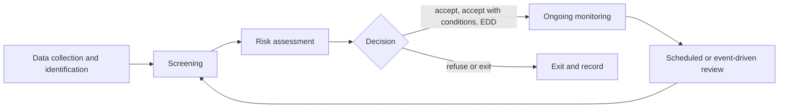

[← Back to README](../README.md)

# Part 1. KYC, CDD and EDD basics

## 1.1 Levels of checks and the customer lifecycle

The depth of a check is set by risk, not by a wish to "check everything": low risk gets simplified checks, standard risk gets CDD, high risk gets EDD. The European AMLR, which applies from 10 July 2027, writes these three levels into law (S).

| Level | When it applies | What it includes |
| --- | --- | --- |
| SDD (simplified due diligence) | Low risk that can be demonstrated; only in cases the rules expressly allow (G) | A reduced set of information and confirmations; monitoring remains |
| CDD (customer due diligence) | The standard for most customers | Identification and verification of the customer and beneficial owner, purpose and nature of the relationship, screening, monitoring |
| EDD (enhanced due diligence) | High risk: PEPs, high-risk countries, complex ownership, unusual transactions, crypto-assets | Additional identification, source of wealth and source of funds, independent sources, senior management approval, enhanced monitoring |

### Risk factors

Assessment is built from four groups: **customer** (type, industry, ownership, PEP status, reputation), **geography** (country of registration, operations and counterparties; FATF lists, sanctions, corruption), **product and channel** (remote onboarding, cash, crypto-assets, intermediaries) and **transactions** (volume, pattern, fit with the profile). Every rating is recorded with its rationale: a black-box rating cannot be defended in front of a supervisor.

### Lifecycle

A check does not end when the customer is accepted. The usual sequence: data collection and identification, screening, risk assessment, decision, ongoing monitoring, scheduled review and event-driven review. For high risk the scheduled review is more frequent (typically annually; medium risk every 2–3 years; low risk every 3–5 years; G: the intervals are set by your policy and regulator).

After the decision the customer stays under monitoring; an event or a scheduled date returns them to screening and risk assessment.

### Events that trigger a review

- a hit on re-screening (sanctions, PEP, adverse media);
- a change of owner, director, beneficial owner or country of registration;
- a new sanctions package or a change in a country's status (FATF, section 4.2);
- an unusual transaction or a sharp change in volume;
- expiry of documents or refusal to provide information;
- a publication about an investigation or a court claim.

### Possible decisions

Accept; accept with conditions (limits, enhanced monitoring); refer to EDD; refuse or end the relationship. Every decision is accompanied by a record: who decided, on what data, against which list versions and on what date. Criteria and the confidence scale are in section 1.3.

## 1.2 Legal framework and limits

Checking a person is permissible when there is a lawful basis, a defined purpose and a proportionate amount of data; anything beyond that is not done, even if the information is "public". The rules below are a guide (G): for your country and role, get a lawyer's review.

| Topic | What to consider |
| --- | --- |
| Basis for processing (GDPR and equivalents) | Consent, legal obligation (for example AML), legitimate interest with a balancing test; the purpose is recorded before work starts |
| Minimisation and retention | Collect only what the decision needs; set retention and deletion periods; do not copy full profiles "just in case" |
| Data on criminal charges and convictions | In the EU processed only within limits set by state law (Article 10 GDPR); access is restricted and retention is short |
| Special categories (health, religion, views, origin) | Not used for assessment; if found by chance, not recorded in the report |
| Employment screening (US) | FCRA: written disclosure and the candidate's consent, pre-adverse and final notices when rejecting on the basis of the report; state requirements exist; a lawyer's review is mandatory |
| Employment screening (UK) | Criminal record certificates through the official mechanism and only for eligible roles; consent is needed; the data protection regulator's guidance is the reference |
| AML and KYC | A legal obligation provides the basis for CDD; tipping off the subject is prohibited; reporting duties depend on the jurisdiction; records are usually kept for at least five years after the relationship ends |
| Sanctions | A breach is possible without intent; decisions are taken on the list version on the date of the transaction |
| Biometrics | Face recognition and biometric verification are regulated separately; Article 5 of the EU AI Act prohibits untargeted scraping of facial images to build recognition databases (S) |

### Practical limits

1. **Consent and notice.** The subject is told what is being checked, why and which sources are used (where the law or ethics require it).
2. **Proportionality.** Depth depends on the role and risk: a stationery supplier does not need a 30-page profile.
3. **Relevance.** Information must relate to the decision. Private life, health, marital status, political and religious views are not part of the assessment.
4. **Accuracy.** A misidentification harms an innocent person; require a second independent identifier (section 2.2).
5. **A human makes the decision.** Automated screening and scoring produce a hypothesis; rejection without human review is not acceptable (G: the EU restricts fully automated decisions).
6. **Right of reply.** For a negative finding, give the person a chance to explain or contest it (section 2.9).
7. **No deception.** No fake personas, no logging in to other people's accounts, no leaked data, no contact with the person's circle.

### Social media

Reviewing open profiles is acceptable if it is needed for the decision and limited by role-based criteria. A practice that reduces the risk of discrimination: one person collects the material and removes information on protected characteristics, a second makes the decision on the filtered material (G).

## 1.3 Output standards: confidence, log, decision

Every conclusion in a report carries a confidence level, a source and a date; "not found" is recorded as a search result, not as proof of absence.

| Level | Definition | Minimum evidence |
| --- | --- | --- |
| Confirmed | The fact is established by an official document or two independent reliable sources | A primary document, or two sources with different chains of origin |
| Probable | The fact is supported by several indirect indicators and there are no contradictions | At least two independent indicators, one of them unique (an identifier, a date of birth) |
| Possible | One indicator or several weak ones; alternatives are not excluded | Alternative explanations written down |
| Unverified | The claim was found but not confirmed | The source and the reason the check was not done |

Many services rate sources on two axes: source reliability (letters A–F) and information credibility (numbers 1–6) (G). What matters is one approach across the team.

### Source log

Kept as you work, not afterwards. For each source: address, date and time of access (UTC), title, what was extracted, type (primary or secondary), reliability, link to the saved copy, file hash (section 7.2). The template is in [templates/](../templates/).

### Decision and approval

| Check result | Typical decision | Who decides |
| --- | --- | --- |
| No matches, data confirmed, low risk | Accept (SDD or CDD) | First-line analyst |
| Questions about ownership or source of funds, unverified claims | EDD, request documents | Analyst with senior sign-off |
| PEP, high-risk country, complex structure, adverse media | EDD and senior management approval; enhanced monitoring | Compliance officer or committee |
| Confirmed sanctions match, beneficial owner cannot be established, refusal to provide information, signs of forgery | Refuse or exit, escalate to legal | Compliance officer, lawyer |

### How to word a conclusion

- "Confirmed: register data on 9.11.2026 shows X, source Y."
- "Probable: two independent indicators (…); alternatives: …"
- "Not established: sources A and B contain no information on…; gap: …"
- Not "the person is dishonest" but "the figure is not confirmed by independent data".

Every report ends with a list of gaps and the date until which the assessment is valid.
