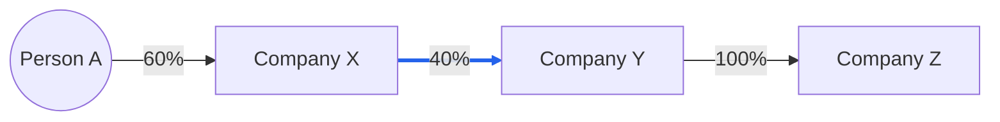

[← Back to README](../README.md)

# Part 3. KYB: checking a company

KYB (know your business) follows the logic of KYC for a legal entity: who it is, who owns it, who manages it, where the money comes from and what confirms the activity. The register gives the skeleton; the other layers test it.

## 3.1 Registers, identifiers, extracts and search order

| Register type | What it contains | What it is for |
| --- | --- | --- |
| Company register | Name, number, registration date, status, address, directors, sometimes shareholders | Existence and history |
| Beneficial ownership register | Individuals who control the company | The ultimate owner (section 3.2) |
| Financial statements | Balance sheet, profit and loss, audit | Scale, related parties, anomalies |
| Register of charges and encumbrances | Pledged property, creditors, guarantors | Credit links |
| Property, vessel and aircraft registers | Owners, history, encumbrances | Assets |
| Courts and insolvency registers | Claims, judgments, procedures | Disputes, debts, liquidations |
| Regulatory registers | Licences, supervisory measures | Legality of the activity |
| Trademarks and patents | Rights holders | Intangible assets |

### Classes of jurisdiction by openness (G)

1. **Open:** online access, often including directors and shareholders (for example the UK Companies House).
2. **Partly open:** basic data free, details for a fee or on request (many EU countries).
3. **Closed or fragmentary:** data through agents, notaries, the court; typical of some offshore jurisdictions and US states with minimal disclosure.

An open register is not the same as a reliable one: find out who verifies the data and how. Aggregators (OpenCorporates and similar) are convenient for search but lag behind, so a conclusion for a report is taken from the register of the country of registration (G).

### Company search order

1. Exact name and legal form, registration number.
2. Country of registration (not necessarily the country of business).
3. Extract: status, registration and amendment dates, address, directors, secretary, shareholders, share capital.
4. History: former names, addresses, directors, reorganisations.
5. Financial statements and filing deadlines; lateness is a red flag.
6. Address: dozens or hundreds of companies at one address mean an agent's address, not activity.
7. Related companies through directors, addresses, phone numbers, domains.
8. Save the extract: date, time, source, hash.

### Identifiers

| Identifier | What it is | Note |
| --- | --- | --- |
| Registration number | The legal entity's number in the national register | Unique within a country; numbers may coincide across countries |
| LEI | 20-character global identifier | The GLEIF database is open; it may include parent structure data (G) |
| Tax number, VAT | Tax identification | VAT can be checked in the EU through the common system (G) |
| BIC/SWIFT, IBAN | Bank and account | An IBAN contains a country code, check digits and a bank code (G) |
| ISIN, CUSIP, FIGI | Securities | Identify the issuer |
| IMO | Vessel number | Stays the same when the name or flag changes |
| ICAO hex | Aircraft code | Tied to the aircraft |
| Crypto wallet address | Identifier on the blockchain | Not equal to an identity |

Check the format and check digits before building hypotheses; keep former identifiers because companies move between jurisdictions; the same number under different names may mean a renamed company, while the same name under different numbers means different companies.

## 3.2 Beneficial ownership and control

A beneficial owner is the individual who ultimately owns or controls a company; the register shows recorded owners, while decisions are made by those who control the money, the directors and the contracts.

| Concept | What it is | Where it is visible |
| --- | --- | --- |
| Formal ownership | The shareholder or participant in the register | The extract |
| Beneficial ownership | An individual with a shareholding or control; the typical threshold is 25% (G) | Ownership registers, documents |
| Effective control | The ability to determine decisions | Decisions, signatures, money, contracts |

### State of the registers

National beneficial-ownership regimes are changing quickly (US, UK, EU). A dated snapshot is in [updates/2026-11.md](../updates/2026-11.md); always confirm against the register of the country concerned.

### Effective share and different counting regimes

Example structure (diagram below): person A owns 60% of company X, X owns 40% of company Y, Y owns 100% of company Z. The same question "does A control company Z" gets different answers.

The share is written above each arrow; blue marks the link where the share does not exceed 50%.

| Rule | How it counts | Result for A and Z |
| --- | --- | --- |
| Effective share (25% beneficial owner threshold) | Multiplication along the chain: 0.60 × 0.40 × 1.00 | 24%: below the threshold |
| Chain of control (more than 50% at every link) | Control passes if the share exceeds 50% at each level | A controls X; X's share in Y is 40%: the chain breaks |
| US sanctions 50% rule (G: check the guidance) | An entity is blocked if blocked persons own 50% or more in aggregate; the shares of blocked persons add up, percentages along the chain are not multiplied | If A is blocked: X is blocked (60%), Y is not blocked (40% held by blocked X), Z is not blocked |
| EU (G) | Ownership of more than 50% and control are considered | Depends on contracts and rights |

**Takeaway:** one structure gives different answers under different regimes; always state in the report which rule you used.

### Signs of control without a shareholding

- the right to appoint and remove directors, veto rights, options, voting agreements;
- a power of attorney to represent interests;
- credit dominance: pledges, guarantees, covenants;
- management and "consulting" contracts with large payments;
- signing rights on bank accounts, shared staff and office;
- the former owner stays on as director or consultant.

### Nominees, trusts, "49/51"

The classic picture: 51% held by a professional trust agent and 49% by an individual. It may mean the agent acts for an unnamed client, that the stake is deliberately below the threshold, or that a power of attorney lets the individual represent the company. A conclusion on the trust's principal without direct evidence remains "possible"; a conclusion on control from the combination of signs may be "probable".

### Algorithm: from claim to beneficial owner

1. Record the claimed structure and the source of the claim.
2. Take extracts for every company in the chain, before and after significant events.
3. Build the chain down to individuals and mark breaks (trust, closed register).
4. Calculate effective shares and state the counting rule.
5. Look for signs of control without a shareholding.
6. Confirm the identity of the holders (section 2.2).
7. Compare with financial statements, courts, procurement.
8. State the conclusion separately: formal ownership, beneficial owner, control; a break in the chain goes into the gaps.

Transfers of shares near events (sanctions, a claim, an inspection, a sale) are the most informative part of the chronology: check the ±30-day window.

## 3.3 Financial statements, related parties, cash flows, assets, courts

You are not an auditor: your job is to find inconsistencies between what is claimed, the financial statements and external reality, and to record them as questions that need an explanation.

### Financial statements

For public companies the main source is regulatory disclosure (in the US the EDGAR system: annual reports 10-K and 20-F, current reports 8-K, insider reports Form 4, stakes 13D/13G and 13F; in the EU the format is gradually moving to ESEF; G). For private companies statements exist where the law requires publication.

| Indicator | How to calculate | Reason to look closer (G) |
| --- | --- | --- |
| Days sales outstanding (DSO) | Receivables ÷ revenue × 365 | A rise of tens of percent in a year |
| Growth of revenue and receivables | Rates over the period | Receivables grow faster than revenue |
| Cash conversion | Operating cash flow ÷ net profit | Persistently below one |
| Revenue per employee | Revenue ÷ average headcount | A jump without headcount growth |
| Share of related parties | Related-party revenue ÷ total | A high share, especially without a named counterparty |
| Contingent liabilities | Guarantees, sureties | Guarantees for related parties |
| Audit | Auditor, opinion, qualifications, change | A change of auditor ahead of a difficult period |

If revenue and staff are claimed, there should be external traces: contracts, procurement, vacancies, public staff profiles, premises, tax data.

### Cash flows and transactions

Payments themselves are rarely visible in open sources, but obligations and encumbrances are: registers of charges (creditor, object, amount, guarantors), notes to financial statements (loans, guarantees, related parties), court exhibits (contracts, invoices, statements), procurement portals. Compare terms with the market: a guarantee without a fee, an interest-free loan with no term, a sale of an asset at an understated price point to common interests of the parties.

### Assets

| Asset | What to distinguish | Sources |
| --- | --- | --- |
| Vessel | Registered owner, operator, technical manager, beneficial owner (work by IMO) | AIS services, registers, classification societies |
| Aircraft | Owner, operator, lessee (ICAO hex code) | ADS-B data, national registers |
| Real estate | Titleholder, tenant, manager | Land registers, transaction registers |
| Rights and marks | Rights holder, licensee | Trademark and patent registers |

Rule: title is not use; independent traces of use weigh more than a single register entry.

### Courts and regulators

US federal courts and their free mirrors, market regulators (SEC, FCA, BaFin and others), Department of Justice press releases, insolvency registers, procurement portals (TED, SAM.gov), debarment lists. Distinguish a charge, a claim and a judgment; record the court, number, date and stage; exhibits to claims often say more about owners than registers do.

## 3.4 Leaks, consortium databases and crypto-assets

Published consortium databases are acceptable as a source of hypotheses; raw leaked documents and stolen credentials are not, without legal assessment.

### Consortium databases (S)

| Source | What it gives | Note |
| --- | --- | --- |
| ICIJ Offshore Leaks Database | More than 810,000 offshore structures from Offshore Leaks, Panama, Paradise, Pandora and Bahamas Leaks; nodes and links with periods; web search, downloadable copies, an API with list reconciliation (since January 2025) | ODbL and CC BY-SA licences, ICIJ must be credited; inclusion in the database does not mean wrongdoing; no bank accounts or correspondence |
| OCCRP Aleph | Document archives, registers and leaks; public search; journalist access to a closed archive | Check name, status and access terms on the project site (G) |
| OpenCorporates, Open Ownership, GLEIF | Registers, ownership data, LEIs | They lag; the primary source matters more (G) |
| OpenSanctions | Sanctions, PEPs, links | Section 4.2 |

### Rules for working with databases

1. The legal question comes first: published databases and raw documents differ.
2. Cross-check on several indicators: names coincide often, so you need an address, date, intermediary, registration date.
3. Time: data relates to a period; the structure may have changed.
4. Draw no conclusions about guilt: an offshore company is a matter of tax and regulation, not proof of crime.
5. Record the database version and snapshot date.
6. Do not publish personal data of people unrelated to the subject.

### Crypto-assets

OFAC has included wallet addresses on the SDN list since 2018. After an exchange is shut down a successor appears: Garantex came under US sanctions in 2022 and was replaced by Grinex, and on 14 August 2025 sanctions were imposed on Grinex, three Garantex executives, related companies and the rouble stablecoin A7A5; on 1 October 2026 OFAC blocked the A7 Network (S). At its October plenary the FATF decided to accelerate implementation of the virtual asset standards in countries with significant activity (S). The EU's 20th package banned RUBx and the digital rouble.

What can be done openly (G): viewing transactions in public block explorers, clustering addresses (a probabilistic method), attribution from sanctions entries and court documents, analysis of stablecoin freezes. After an exchange the trail usually stops by open methods.

**Limits:** an address is not an identity; contact with an address does not prove guilt; linking to a person is personal data. Commercial tools (Chainalysis, TRM Labs, Elliptic) give attribution and risk scores but are paid and closed: confirm their conclusions independently.
